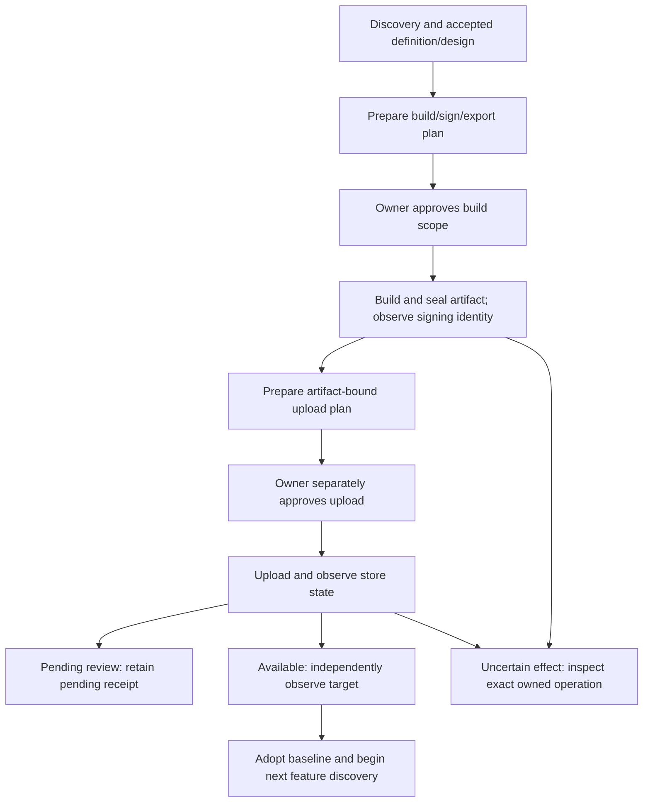

# Native production release

The v0.2.16 adapter passed its repaired nine-gate complete source journey
and independent source review. The clean installed package also passed the
complete feature-slice suite, including all nine release gates. Actual signing,
store upload, distribution and production adoption remain unqualified until
their own observed evidence exists. The separately qualified `native_local`
profile keeps its simulator/emulator limits.

The candidate CLI exposes:

```sh
faktori product native-release-prepare configuration-binding-request.json
faktori product native-release-build approved-build-request.json
faktori product native-release-upload-prepare signed-build-receipt-request.json
faktori product native-release-upload separately-approved-upload-request.json
faktori product native-release-inspect phase-inspection-request.json
faktori product native-release-reconcile approved-read-only-reconciliation.json
```

Preparation and inspection do not authorize effects. Build and upload requests
have distinct phase and approval bindings; the upload plan is prepared only
after the actual signed build receipt is available.



Requirements discovery and separately accepted definition/design establish the
platforms, app identity, backend/API/client contracts and intended distribution.
A sealed preparation plan binds that scope, exact source, output locations,
tool identities and independently approved observer/evaluator files. Missing
publisher accounts or signing resources cannot become an inferred approval.

Build/sign/export use an explicit owner approval for their concrete command
scope. The controller runs the configured tools through the existing bounded
deployment executor, retains intent before effects and observations afterward,
then seals the actual IPA/AAB bytes and independently observed signing identity.
Native account authentication stays in the vendor's existing flow; credentials
are not copied into product workspaces or factory evidence.

Upload is a separate handoff. First prepare its concrete plan from the actual
sealed artifact, signing identity, publisher/account/app/build and selected
track. Only a new owner approval for that exact plan can authorize upload.
Accepted requirements, design or build approval cannot authorize publication.
Pending store review is retained as pending. An uploaded artifact is not proof
that the intended distribution is available.

Read-only provider/device observation binds actual distribution state to the
same artifact, app/build/track and accepted contracts. Only qualified observed
availability can proceed to the existing product observation/adoption journal
and next discovery cycle. Beta distribution remains distinct from public
production. Subsequent features inherit the observed baseline and its limits.

Each effect retains a durable intent and result. Interrupted or ambiguous
effects prevent another launch. Inspection returns safe stored summaries;
reconciliation requires a new read-only approval bound to the original receipt
and protected observer. It observes the same operation without resubmitting or
restoring upload authority. Source, command, artifact or
observer changes require fresh preparation and applicable approval.

Whole-feature fixtures qualify the controller's authority, binding, recovery
and lifecycle behavior. Synthetic export files and observer responses do not
establish real archive validity, signing, store access or device behavior.

The `native_vendor` profile depends on protected, byte-pinned operator SDK
wrappers to report actual account, archive format, signatures and distribution.
Imported tool dependencies and vendor credential custody remain attended
operator responsibilities; byte binding does not provide OS-hermetic isolation
or independently reproduce a signed binary. Runtime identity binds app/build,
artifact, account, signing and track observations; physical-device identity and
OS coverage still require their own qualification evidence.

The `synthetic_fixture` profile must deny actual account, signature and archive
format qualification. It can enter only `local_qualification`, never beta or
public production adoption.
